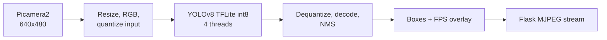

# custom-trained-yolov8-bird-detector-pi5

I trained a machine learning model to run on a Raspberry Pi 5 and detect birds on my balcony. It runs on the Pi's CPU with no accelerator and streams the annotated camera feed to a browser.

## The problem

I wanted to know when birds land on my balcony. A general COCO detector spends its capacity on 80 classes when I only care about birds, and whatever I use has to run on the Pi's CPU.

## What I built

A YOLOv8n model I fine-tuned on four garden bird species (blue tit, great tit, robin, sparrow), exported to TFLite with int8 quantization, and a Pi app around it.

- Picamera2 capture at 640x480
- TFLite inference on 4 threads
- Boxes, confidence and FPS drawn on each frame
- Live MJPEG stream at `http://<pi-ip>:5000/`

The model was developed and benchmarked on a laptop first, in [bird-recognition-mac](https://github.com/elie-hallermeier/bird-recognition-mac).

## Architecture



| Path | What it is |
|---|---|
| `src/app.py` | Capture, inference, post-processing and the web stream |
| `models/best_int8.tflite` | The quantized model the Pi runs |
| `models/best.pt` | The PyTorch weights it was exported from |
| `training/train.py` | Trains the model |
| `training/export.py` | Exports it to int8 TFLite |
| `training/results.csv` | Per-epoch training log |

## Training

I fine-tuned the COCO-pretrained `yolov8n.pt` (3 million parameters) for 50 epochs at 320x320 on the Bird-Feeder-1 dataset, with everything else at the Ultralytics defaults. Training took under 6 minutes.

Results on the dataset's validation split:

| Metric | Value |
|---|---|
| Precision | 0.970 |
| Recall | 0.985 |
| mAP50 | 0.985 |
| mAP50-95 | 0.864 |

mAP50 was already 0.95 after 5 epochs. The remaining epochs mostly tightened the boxes, taking mAP50-95 from 0.72 to 0.86. The full curve is in `training/results.csv`.

To reproduce it, put the dataset in YOLO format at `Bird-Feeder-1/` and run:

```bash
pip install -r training/requirements.txt
```

```bash
python training/train.py
```

```bash
python training/export.py
```

The export writes `best_int8.tflite`, which is the file in `models/`.

## Design decisions

- Four classes instead of 80, and a 320 px input. A narrow job is what makes a nano-sized network good enough, and the small input is what makes it fast on a CPU.
- The app reports every detection as "bird". It takes the best score across the four species, so a bird the model is unsure how to name still counts.
- int8 quantization for the Pi CPU. The app reads the scale and zero point from the model itself, so the same code runs float32, uint8 and int8 exports without changes.
- Post-processing adapts to the export. It detects whether the output is laid out as (boxes, values) or the transpose, and whether coordinates are normalized or in pixels, because that differs between export settings.
- A low NMS IoU threshold (0.10). Birds on a railing rarely overlap, so anything overlapping is almost always a duplicate box of the same bird.
- `DETECT_EVERY_N_FRAMES` trades detection rate for stream smoothness. The last boxes are redrawn on skipped frames.
- `tflite-runtime` instead of full TensorFlow on the Pi, with a fallback import so the same file runs on a laptop.

## Setup

On the Pi:

```bash
sudo apt install -y python3-picamera2 python3-opencv
```

```bash
git clone https://github.com/elie-hallermeier/custom-trained-yolov8-bird-detector-pi5.git
```

```bash
cd custom-trained-yolov8-bird-detector-pi5 && python3 -m venv --system-site-packages .venv && .venv/bin/pip install -r requirements.txt
```

## Run

```bash
.venv/bin/python src/app.py
```

Open `http://<pi-ip>:5000/` from any device on the same network.

Thresholds, resolution and thread count are in the config block at the top of `src/app.py`.
